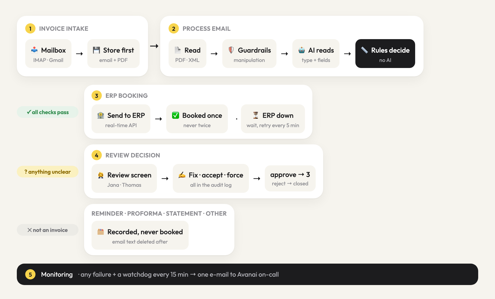

# Take-home task: Invoice intake for Hallmann Maschinenbau

I built a system where invoices come in by email, clean ones are booked in the ERP on their own, and everything else goes to Jana and Thomas.

- Review screen: https://hallmann-invoices.vercel.app
- Walkthrough: `docs/invoice-journey.pdf`
- n8n workflows: `workflows/`
- Go-live checklist: `docs/PRODUCTION-CHECKLIST.md`



## Run it

```bash
cp .env.example .env    # fill in the keys
./scripts/setup.sh      # starts everything and imports the workflows
python3 scripts/send-emails.py
```

## How it is built, and why

- Five n8n workflows: Intake, Process Email, ERP Booking, Review Decision and Monitoring.
- The AI only reads the invoice; plain rules decide what gets booked.
- Every amount must appear in the document and net plus VAT must equal gross, so net and gross can't be mixed up again.
- Unknown suppliers, changed bank details and look-alike senders always go to a person.
- Nothing above 10,000 € is booked without a person, the same limit a clerk has.
- Every email is saved first, so nothing is lost if something breaks.
- When the ERP is down, the invoice waits and is retried every 5 minutes, and it is never booked twice.
- On the review screen, you see the original PDF next to the fields and fix what is marked red.
- Every change is saved with who, when, and the values before and after.

## How I know it works

- 30 unit tests on the rules all pass.
- Sabine's 12 sample emails plus 7 harder ones went through a real mailbox and all ended up in the right place.
- 26 different invoice layouts were tested, and 25 behaved as expected.
- I also tested it end to end with a real Gmail account.
- Used PlayWright Smokescreen testing & n8n MCP to test multiple invoices via Claude

## What I would add before this runs for a real client

- Connect Hallmann's real ERP, which is a mock today.
- Get a dedicated invoice mailbox from Hallmann IT.
- Move the AI to an EU-hosted provider, Host it properly, with HTTPS and backups.
- Sync the supplier list from the ERP every night. A dedicated workflow
- Ask real invoice samples from the client, Run a pilot on real invoices with automatic booking switched off.

## Future scope (What I didn't finished)

- OCR for handwritten invoices.
- Invoices with two VAT rates go to a person.
- Early-payment discounts (Skonto) are not captured.
- The manipulation check sometimes flags genuine invoices and needs tuning.
- Better access management, audit trail & observability

## Where I used AI coding tools

- I used Claude Code & n8n MCP with Claude to write most of the code and tests; the decisions and the testing are mine.

Best, Kailash
