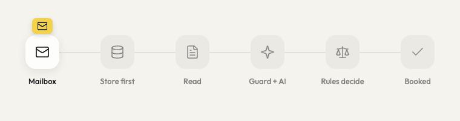
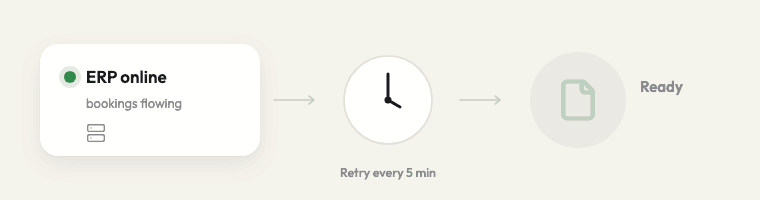

# Invoice intake for Hallmann Maschinenbau — Avanai trial task



Supplier invoices arrive in a mailbox. n8n reads them, the AI extracts the fields, **deterministic rules decide**, and only clean invoices are booked in the ERP. Everything else goes to Jana and Thomas on a simple review screen, with the reason and the original PDF next to the fields. Nothing is lost, nothing is booked twice, and every change is in an append-only audit log.

- **Review screen (live demo):** https://hallmann-invoices.vercel.app (Google sign-in, allow-listed accounts)
- **One-page visual walkthrough:** [docs/invoice-journey.pdf](docs/invoice-journey.pdf)
- **n8n workflows:** [workflows/](workflows/) (import guide inside)
- **Before go-live:** [docs/PRODUCTION-CHECKLIST.md](docs/PRODUCTION-CHECKLIST.md)

## Run it

```bash
cp .env.example .env            # SARVAM_API_KEY, passwords, Firebase web config, INITIAL_ADMIN_EMAIL
./scripts/setup.sh              # Postgres, mailbox, mock ERP, review app, n8n; credentials + workflows imported
python3 scripts/send-emails.py  # deliver the 12 sample emails (+ edge cases) to the invoice mailbox
open http://localhost:3001      # review screen        ·  n8n: http://localhost:5678
```
`scripts/demo-reset.sh` wipes the data and loads a 12-email hands-on set. `scripts/erp.sh down|up` simulates unannounced ERP maintenance.

## 1. How it is built, and why

| Workflow | Job |
|---|---|
| **Invoice Intake** | Reads the mailbox (IMAP or Gmail). Stores every email and its original files in Postgres **before** anything can fail, labels Gmail mail "Processed", then hands each email to its own run. |
| **Process Email** | Reads every PDF/XML attachment (XRechnung/ZUGFeRD fields straight from the XML). Guardrails check for manipulation. The AI classifies 7 types (invoice, credit note, reminder, proforma, order confirmation, statement, other) and extracts fields. The **rules decide**; one save node; clean invoices go to booking. |
| **ERP Booking** | The only place that writes to the ERP: claim (row lock) → real-time API call → the ERP's answer decides (booked · 409 duplicate · 4xx back to a person · 503/no answer = maintenance, retried every 5 min). Never twice: the document id is the idempotency key. |
| **Review Decision** | Approve / save / reject / reopen from the screen. Shared secret on the webhook, role re-read from the user table, the same rules re-run, before/after written to the audit log. |
| **Monitoring** | Any workflow failure, plus a 15-minute watchdog (stuck emails, old queues, silent mailbox) → one alert per problem and an e-mail to Avanai on-call. |

**Why it is shaped like this**
- **The AI never decides.** Sabine's past tool mixed up net and gross unnoticed. Here the model only reads; a plain-JavaScript validator (`shared/validate.js`, unit-tested, byte-identical in n8n and the review app) is the only gate. Every amount, the invoice number and the VAT ID must literally appear in the document, net + VAT must equal gross, the VAT rate must fit the country, and duplicates are matched even when the number is written differently.
- **Fraud is a booking problem too.** A supplier master (VAT ID, IBAN, sender domains) catches unknown suppliers, changed bank details and look-alike senders. Auto-booking is capped at 10,000 € (the clerk limit).
- **People stay in control, visibly.** Red fields must be fixed, amber items can be accepted with a note, and a lead can force a booking through a confirmation popup (logged as FORCED; the ERP still rejects contradictory amounts). Amounts auto-calculate from gross; foreign currencies show today's ECB rate.
- **Nothing gets lost.** IMAP marks mail read on fetch, so the email is stored first; Monitoring re-runs anything without a result. Emails with nothing to book are reduced to metadata (data minimisation).
- **Postgres, not n8n Data Tables**, because auditors need transactions, unique keys and an append-only log the review app can read.

**Mailbox access.** Gmail/IMAP permissions always cover a whole mailbox, so the real control is a dedicated invoice mailbox set up by Hallmann IT. The Gmail credential uses `gmail.modify` (read + label) instead of n8n's full-access default; the workflow has no send or delete node.

**Assumptions I made where the brief was open**
- "Several hundred a month" means a few per hour: emails are processed strictly one at a time, so correctness beats speed.
- An invoice may arrive in the email body (as in the samples), as a PDF, or as an XRechnung/ZUGFeRD e-invoice; all three are handled.
- "Nothing wrong in the ERP" outranks "books itself": anything the rules cannot prove goes to a person, and auto-booking stops at 10,000 € gross.
- Jana and Thomas are clerks (approve up to 10,000 €); Sabine is a lead (approves above that, accepts exceptions, reopens rejections). Sign-in is Google with an allow-list.
- Foreign-currency invoices and non-EU VAT are booked only after a person confirms them.
- The ERP is unknown, so ERP Booking talks to a mock booking API with the behaviour of a real one (idempotency, 409, 503).
- "Hear it from you" means e-mail to Avanai on-call today; the channel is configurable.

## 2. How I know it works

| Suite | What it proves |
|---|---|
| `npm test` (30 tests) | Validator rules incl. grounding, fraud, tax, dates, number formats; workflow structure (wiring, webhook auth, retries, no secrets in exports, validator not drifted) |
| `scripts/e2e.py` (19 emails) | The client's 12 samples + edge cases through a **real mailbox**: duplicates, reminders, credit notes, forwards, injection, PDF-only, proforma, invoice + T&C PDF, look-alike sender, changed IBAN |
| `scripts/format-test.py` (26 cases) | Real-world layouts: tables, two pages, two VAT rates, Skonto, US/UK/German dates, two-column, French number format, XRechnung, official ZUGFeRD and Factur-X samples, a real Hetzner invoice |
| `scripts/outage-test.py` | ERP down without notice → waits, one alert, one e-mail; ERP back → booked exactly once, alert closed |



Also verified by hand: Gmail end to end on a real account (invoice booked, label applied), the review screen flows, forced approval refused by the ERP and logged.

## 3. Before a real client

The short version (full list in [docs/PRODUCTION-CHECKLIST.md](docs/PRODUCTION-CHECKLIST.md)):
1. **Hallmann's ERP.** We built against a booking contract and a mock ERP. Need: which ERP (SAP, Business Central, proALPHA, DATEV…), its posting API and test system, where account / cost centre / tax code come from, and what it answers during maintenance.
2. **EU-hosted model under a DPA.** Sarvam-105B was used because a key was at hand (hosted in India). Production: Mistral, Azure OpenAI EU or Claude via Bedrock Frankfurt; one credential change, then re-run the suites.
3. **Dedicated mailbox, real hosting** (server, HTTPS, backups, secrets), supplier master synced nightly from the ERP.
4. **A pilot on real, anonymised Hallmann invoices** before switching auto-booking on.

## What I propose next

1. **Week 1–2:** connect Hallmann's ERP sandbox and mailbox, EU-hosted model, deploy on a Hallmann/Avanai server.
2. **Week 3–6, pilot:** real invoices, auto-booking **off**. Every invoice goes to Jana and Thomas, the system shows what it would have done; we measure how often it was right.
3. **Then:** switch auto-booking on supplier by supplier once the numbers are agreed; Sabine gets a weekly digest (volume, auto-book rate, open items).

## 4. What I didn't finish

- **Very long invoices** (60+ lines) can still fail extraction and go to a person; needs page-wise extraction.
- **Scanned PDFs** (no text layer) go to a person; OCR is a go-live item.
- **Several VAT rates on one invoice** always go to a person; no VAT breakdown yet. Skonto terms are not captured.
- **Suppliers without a VAT ID** (outside the EU) are matched for duplicates less reliably.
- **Hosting:** the live demo is the review screen on Vercel, with its API tunnelled to the stack on my machine. It is a demo link, not a deployment.

## Where I used AI coding tools

Built with Claude Code (Anthropic) as a pair programmer: it wrote most of the code (n8n workflow generator, validator and tests, review app, scripts), ran the test suites, and reviewed the design with separate review passes (n8n platform, accounts-payable edge cases, reliability and LLM safety). I made the product and design decisions, set the rules, tested the flows by hand (including Gmail end to end on a real account) and reviewed the output. Inside the product, the AI (Sarvam-105B via n8n's LangChain nodes) only classifies and extracts; it never decides what is booked.
